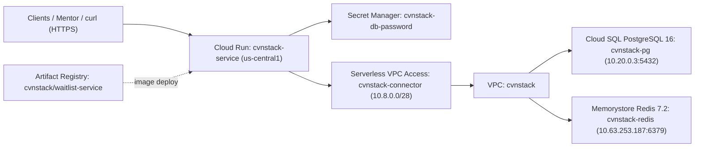

<!-- AI-assisted. -->

# CVNStack GCP Deployment Guide

This document records the shared Google Cloud Platform (GCP) project, networking, managed PostgreSQL and Redis onboarding, Cloud Run deployment commands, and the live mentor walkthrough for CVNStack. No secrets or passwords are stored in this file.

## Architecture overview



## 1. Project, region, APIs, IAM, and VPC (issue #42)

### Project and region

| Setting | Value |
| --- | --- |
| Project ID | `cvnstack` |
| Project Name | `CVNStack` |
| Project Number | `806111529624` |
| Region | `us-central1` |
| Zone | `us-central1-a` |
| Billing | Enabled |

### Enabled APIs

The following GCP APIs are enabled on `cvnstack` for networking, managed stores, container registry, secret management, and serverless hosting:

- `compute.googleapis.com` (Compute Engine and VPC networking)
- `servicenetworking.googleapis.com` (Private Services Access for managed stores)
- `vpcaccess.googleapis.com` (Serverless VPC Access)
- `sqladmin.googleapis.com` (Cloud SQL Admin)
- `redis.googleapis.com` (Memorystore for Redis)
- `secretmanager.googleapis.com` (Secret Manager)
- `artifactregistry.googleapis.com` (Artifact Registry)
- `run.googleapis.com` (Cloud Run)
- `iam.googleapis.com` and `iap.googleapis.com` (IAM and Identity-Aware Proxy)

Reproducible command to enable the Iteration 2 service APIs:

```bash
gcloud services enable \
  run.googleapis.com \
  sqladmin.googleapis.com \
  redis.googleapis.com \
  secretmanager.googleapis.com \
  vpcaccess.googleapis.com \
  artifactregistry.googleapis.com \
  --project=cvnstack
```

### VPC and Serverless VPC Access connector

| Resource | Name / Value |
| --- | --- |
| VPC network | `cvnstack` (custom subnet mode) |
| Primary subnet | `cvnstack` (`us-central1`, `10.10.0.0/24`) |
| Private Services Access range | `cvnstack-psa-range` (`10.20.0.0/16`) |
| Serverless VPC Access connector | `cvnstack-connector` |
| Full connector resource | `projects/cvnstack/locations/us-central1/connectors/cvnstack-connector` |
| Connector IP CIDR range | `10.8.0.0/28` |
| Connector sizing | `e2-micro`, min 2 / max 3 instances (200-300 Mbps) |
| Verified state | `READY` (2026-11-25) |

Reproducible command used to create and verify the connector:

```bash
gcloud compute networks vpc-access connectors create cvnstack-connector \
  --project=cvnstack \
  --region=us-central1 \
  --network=cvnstack \
  --range=10.8.0.0/28 \
  --min-instances=2 \
  --max-instances=3 \
  --machine-type=e2-micro

gcloud compute networks vpc-access connectors describe cvnstack-connector \
  --project=cvnstack \
  --region=us-central1
```

### IAM access

| Member | Role | Purpose |
| --- | --- | --- |
| `zk2343@columbia.edu` | `roles/owner` | Project owner and billing/IAM administrator |
| `yk3193@columbia.edu` | `roles/owner` | GCP onboarding, Cloud Run deployment, and IAM |
| `dw3258@columbia.edu` | `roles/owner` | Teammate verification and integration |
| `cvnstack-run@cvnstack.iam.gserviceaccount.com` | `roles/secretmanager.secretAccessor` (on `cvnstack-db-password`), `roles/cloudsql.client` | Dedicated runtime service account for Cloud Run |

Command to grant mentor project access when needed:

```bash
gcloud projects add-iam-policy-binding cvnstack \
  --member="user:<MENTOR_GOOGLE_EMAIL>" \
  --role="roles/viewer"
```

## 2. Cloud SQL for PostgreSQL (issue #43)

### Instance and secret details

| Setting | Value |
| --- | --- |
| Instance name | `cvnstack-pg` |
| Connection name | `cvnstack:us-central1:cvnstack-pg` |
| Region / Zone | `us-central1` (`us-central1-f`) |
| Database version | `POSTGRES_16` (PostgreSQL 16.15) |
| Edition / Tier | `ENTERPRISE`, `db-f1-micro` (10 GB SSD) |
| VPC network | `projects/cvnstack/global/networks/cvnstack` (Private Services Access `10.20.0.0/16`) |
| Private IP | `10.20.0.3` (`ipv4Enabled: false`, private IP only) |
| Database name | `cvnstack` |
| Application user | `cvnstack` |
| Password secret | Secret Manager `cvnstack-db-password` (version `latest`, not committed to repo) |
| JDBC URL (`DATABASE_URL`) | `jdbc:postgresql://10.20.0.3:5432/cvnstack` |
| Flyway verification | Applied `V1__create_waitlist_schema.sql` and `V2__client_instance.sql` on Cloud Run startup (2026-11-27) |
| Verified state | `RUNNABLE` (2026-11-27) |

### Reproducible commands

```bash
# 1. Reserve private IP range and connect Private Services Access
gcloud compute addresses create cvnstack-psa-range \
  --project=cvnstack \
  --global \
  --purpose=VPC_PEERING \
  --prefix-length=16 \
  --addresses=10.20.0.0 \
  --network=cvnstack

gcloud services vpc-peerings connect \
  --project=cvnstack \
  --service=servicenetworking.googleapis.com \
  --ranges=cvnstack-psa-range \
  --network=cvnstack

# 2. Store a generated password in Secret Manager (no secret in repo)
gcloud secrets create cvnstack-db-password \
  --project=cvnstack \
  --replication-policy=automatic

openssl rand -base64 32 | tr -dc 'A-Za-z0-9' | head -c 28 | \
  gcloud secrets versions add cvnstack-db-password \
  --project=cvnstack \
  --data-file=-

# 3. Create Cloud SQL instance, database, and application user
gcloud sql instances create cvnstack-pg \
  --project=cvnstack \
  --database-version=POSTGRES_16 \
  --tier=db-f1-micro \
  --edition=ENTERPRISE \
  --region=us-central1 \
  --network=projects/cvnstack/global/networks/cvnstack \
  --no-assign-ip \
  --storage-size=10GB \
  --storage-type=SSD

gcloud sql databases create cvnstack --instance=cvnstack-pg --project=cvnstack

DB_PASS="$(gcloud secrets versions access latest --secret=cvnstack-db-password --project=cvnstack)"
gcloud sql users create cvnstack --instance=cvnstack-pg --project=cvnstack --password="$DB_PASS"
unset DB_PASS
```

## 3. Memorystore for Redis (issue #44)

### Instance details

| Setting | Value |
| --- | --- |
| Instance name | `cvnstack-redis` |
| Full resource | `projects/cvnstack/locations/us-central1/instances/cvnstack-redis` |
| Region | `us-central1` |
| Tier and size | `BASIC`, `1 GB` |
| Redis version | `REDIS_7_2` |
| VPC network | `projects/cvnstack/global/networks/cvnstack` (`DIRECT_PEERING`) |
| Private host (`REDIS_HOST`) | `10.63.253.187` |
| Port (`REDIS_PORT`) | `6379` |
| TLS / AUTH | Disabled on private VPC (`REDIS_SSL=false`, no `REDIS_PASSWORD`) |
| Verified state | `READY` (2026-11-26; verified `PING -> +PONG` over VPC on 2026-11-27) |

### Application configuration keys

The service reads the same Redis configuration keys already defined in `src/main/resources/application.properties` (no code change required):

| Environment variable | Spring property | Value for `cvnstack-redis` |
| --- | --- | --- |
| `REDIS_HOST` | `spring.data.redis.host` | `10.63.253.187` |
| `REDIS_PORT` | `spring.data.redis.port` | `6379` |
| `REDIS_SSL` | `spring.data.redis.ssl.enabled` | `false` |

### Reproducible commands

```bash
gcloud redis instances create cvnstack-redis \
  --project=cvnstack \
  --region=us-central1 \
  --tier=basic \
  --size=1 \
  --redis-version=redis_7_2 \
  --network=projects/cvnstack/global/networks/cvnstack \
  --connect-mode=DIRECT_PEERING

gcloud redis instances describe cvnstack-redis \
  --project=cvnstack \
  --region=us-central1 \
  --format="table(name,host,port,state,redisVersion,tier,memorySizeGb,authorizedNetwork)"
```

## 4. Cloud Run deployment (issue #45)

### Service and image details

| Setting | Value |
| --- | --- |
| Service name | `cvnstack-service` |
| Region | `us-central1` |
| Live public URL | `https://cvnstack-service-xgl4tzechq-uc.a.run.app` |
| Artifact Registry repository | `us-central1-docker.pkg.dev/cvnstack/cvnstack` |
| Image path | `us-central1-docker.pkg.dev/cvnstack/cvnstack/waitlist-service:latest` (deployed revision built from `0c9dfc2`) |
| Runtime service account | `cvnstack-run@cvnstack.iam.gserviceaccount.com` |
| VPC connector | `cvnstack-connector` (`--vpc-egress=private-ranges-only`) |
| Sizing | 1 vCPU, 512 MiB RAM, min 0 / max 2 instances, port `8080` |
| Store verification on boot | `VERIFY_STORES=true` (Flyway migrates Cloud SQL and `RedisStartupCheck` pings Memorystore before serving traffic) |
| Public access | Enabled (`--allow-unauthenticated`) |

### Build, push, and deploy commands

```bash
# 1. Create Artifact Registry repository (one-time)
gcloud artifacts repositories create cvnstack \
  --project=cvnstack \
  --repository-format=docker \
  --location=us-central1 \
  --description="CVNStack service container images for Cloud Run"

# 2. Create dedicated service account and grant least-privilege access (one-time)
gcloud iam service-accounts create cvnstack-run \
  --project=cvnstack \
  --display-name="CVNStack Cloud Run service"

gcloud secrets add-iam-policy-binding cvnstack-db-password \
  --project=cvnstack \
  --member="serviceAccount:cvnstack-run@cvnstack.iam.gserviceaccount.com" \
  --role="roles/secretmanager.secretAccessor"

gcloud projects add-iam-policy-binding cvnstack \
  --member="serviceAccount:cvnstack-run@cvnstack.iam.gserviceaccount.com" \
  --role="roles/cloudsql.client"

# 3. Build and push the linux/amd64 image from the repository root
gcloud auth configure-docker us-central1-docker.pkg.dev --quiet
SHA="$(git rev-parse --short HEAD)"
IMAGE="us-central1-docker.pkg.dev/cvnstack/cvnstack/waitlist-service"
docker build --platform linux/amd64 -t "${IMAGE}:${SHA}" -t "${IMAGE}:latest" .
docker push "${IMAGE}:${SHA}"
docker push "${IMAGE}:latest"

# 4. Deploy to Cloud Run
gcloud run deploy cvnstack-service \
  --project=cvnstack \
  --region=us-central1 \
  --image="${IMAGE}:${SHA}" \
  --service-account=cvnstack-run@cvnstack.iam.gserviceaccount.com \
  --vpc-connector=cvnstack-connector \
  --vpc-egress=private-ranges-only \
  --set-env-vars="DATABASE_URL=jdbc:postgresql://10.20.0.3:5432/cvnstack,DATABASE_USERNAME=cvnstack,REDIS_HOST=10.63.253.187,REDIS_PORT=6379,REDIS_SSL=false,VERIFY_STORES=true" \
  --set-secrets="DATABASE_PASSWORD=cvnstack-db-password:latest" \
  --port=8080 \
  --memory=512Mi \
  --cpu=1 \
  --min-instances=0 \
  --max-instances=2 \
  --allow-unauthenticated
```

## 5. Live walkthrough for the mentor (issue #46)

Live base URL:

```bash
export BASE_URL="https://cvnstack-service-xgl4tzechq-uc.a.run.app"
```

Every mutating route requires the `X-Client-Instance` header so requests from different client machines stay distinct in PostgreSQL and Redis. The steps below can be run in order from any machine with `curl` and `python3` (or `jq`).

### Step 1 - Health check

- **Expected status:** `200 OK`
- **Expected body:** `{"status":"UP"}`

```bash
curl -sS -i "$BASE_URL/health"
```

### Step 2 - Create a waitlist (client instance A)

- **Sample input:** `name` = unique waitlist name, `maxLength` = `10`, `processingTimePerEntryMinutes` = `5`, header `X-Client-Instance: mentor-demo-a`
- **Expected status:** `200 OK` with generated `id` and `"clientInstance":"mentor-demo-a"`

```bash
WL_NAME="Mentor-Demo-$(date +%s)"
WL_JSON=$(curl -sS -X POST "$BASE_URL/waitlists" \
  -H "Content-Type: application/json" \
  -H "X-Client-Instance: mentor-demo-a" \
  -d "{\"name\":\"$WL_NAME\",\"maxLength\":10,\"processingTimePerEntryMinutes\":5}")
echo "$WL_JSON"
WL_ID=$(python3 -c 'import json,sys; print(json.loads(sys.stdin.read())["id"])' <<< "$WL_JSON")
```

### Step 3 - Add two entries from two client instances

- **Sample input 1 (instance A):** `{"name":"Alice","priority":1}` -> **Expected:** `200 OK`, `status: "WAITING"`, `position: 1`, `estimatedWaitTimeMinutes: 0`, `clientInstance: "mentor-demo-a"`
- **Sample input 2 (instance B):** `{"name":"Bob","priority":5}` -> **Expected:** `200 OK`, `status: "WAITING"`, `position: 1` (priority 5 moves ahead of priority 1), `estimatedWaitTimeMinutes: 0`, `clientInstance: "mentor-demo-b"`

```bash
ALICE_JSON=$(curl -sS -X POST "$BASE_URL/waitlists/$WL_ID/entries" \
  -H "Content-Type: application/json" \
  -H "X-Client-Instance: mentor-demo-a" \
  -d '{"name":"Alice","priority":1}')
echo "$ALICE_JSON"
ALICE_ID=$(python3 -c 'import json,sys; print(json.loads(sys.stdin.read())["entryId"])' <<< "$ALICE_JSON")

BOB_JSON=$(curl -sS -X POST "$BASE_URL/waitlists/$WL_ID/entries" \
  -H "Content-Type: application/json" \
  -H "X-Client-Instance: mentor-demo-b" \
  -d '{"name":"Bob","priority":5}')
echo "$BOB_JSON"
BOB_ID=$(python3 -c 'import json,sys; print(json.loads(sys.stdin.read())["entryId"])' <<< "$BOB_JSON")
```

### Step 4 - Inspect the waitlist and Alice's updated position

- **Expected status:** `200 OK`
- **Expected outcome:** `GET /waitlists/$WL_ID` lists Bob first (`priority: 5`, `position: 1`, `clientInstance: "mentor-demo-b"`) and Alice second (`priority: 1`, `position: 2`, `estimatedWaitTimeMinutes: 5`, `clientInstance: "mentor-demo-a"`).

```bash
curl -sS "$BASE_URL/waitlists/$WL_ID"
echo
curl -sS "$BASE_URL/waitlists/$WL_ID/entries/$ALICE_ID"
echo
```

### Step 5 - Serve the next waiting entry

- **Expected status:** `200 OK`
- **Expected outcome:** Selects Bob (`priority: 5`), transitions status to `CALLED`, preserves `"clientInstance":"mentor-demo-b"`.

```bash
curl -sS -i -X POST "$BASE_URL/waitlists/$WL_ID/serve-next" \
  -H "X-Client-Instance: mentor-demo-a"
```

### Step 6 - Mark Bob SERVED, remove Alice, and confirm empty serve-next

- `PATCH` Bob to `{"status":"SERVED"}` -> **Expected:** `200 OK` (`position: null`, `estimatedWaitTimeMinutes: null`)
- `DELETE` Alice -> **Expected:** `200 OK` (`"message":"Entry successfully removed"`)
- `POST /serve-next` on empty waitlist -> **Expected:** `204 No Content` (empty body)

```bash
curl -sS -X PATCH "$BASE_URL/waitlists/$WL_ID/entries/$BOB_ID" \
  -H "Content-Type: application/json" \
  -H "X-Client-Instance: mentor-demo-a" \
  -d '{"status":"SERVED"}'
echo

curl -sS -X DELETE "$BASE_URL/waitlists/$WL_ID/entries/$ALICE_ID" \
  -H "X-Client-Instance: mentor-demo-a"
echo

curl -sS -i -X POST "$BASE_URL/waitlists/$WL_ID/serve-next" \
  -H "X-Client-Instance: mentor-demo-a"
```

### Running the independent restaurant client against Cloud Run

Point `mocked_client` at the live Cloud Run URL with `--base-url`:

```bash
BASE_URL="https://cvnstack-service-xgl4tzechq-uc.a.run.app" \
  mocked_client/scripts/call-local-port.sh
```

Or launch the local host stand UI against Cloud Run:

```bash
mocked_client/scripts/run-gcp.sh --base-url "https://cvnstack-service-xgl4tzechq-uc.a.run.app"
```
